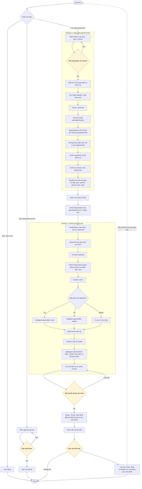
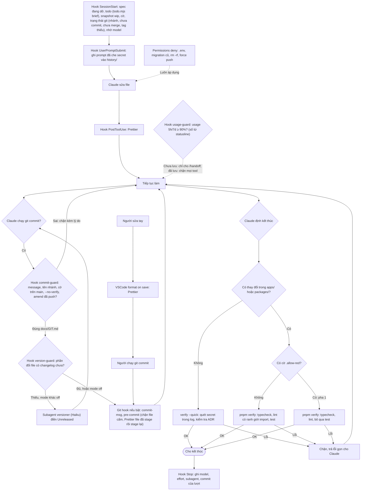
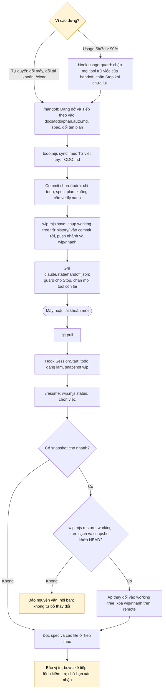
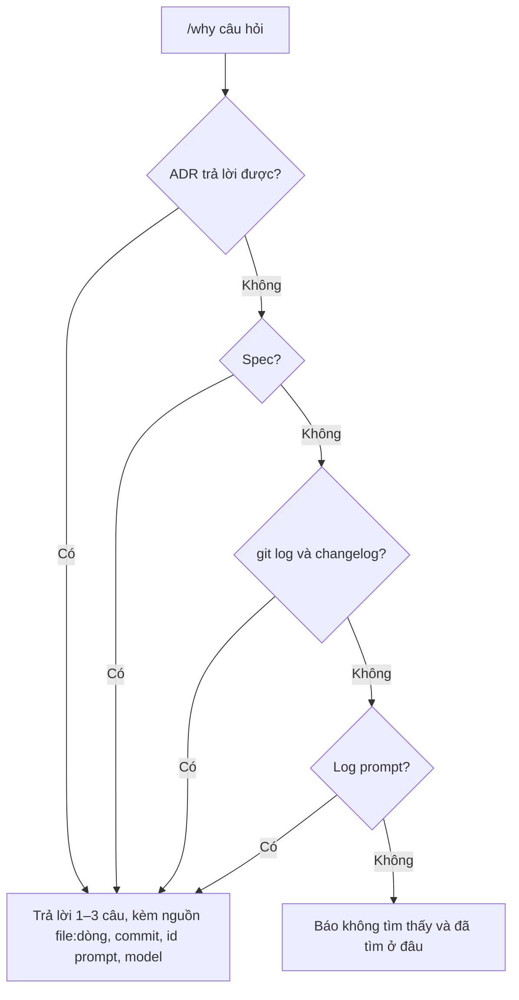
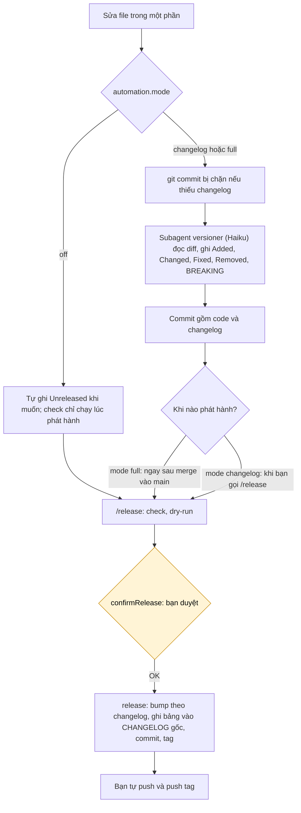

# Quy trình làm việc với Claude Code

> Sơ đồ này phản ánh cấu hình hiện tại trong `.claude/`. Khi đổi command, hook, subagent hay quy tắc phân loại task, cập nhật sơ đồ trong cùng commit.

## Tổng quan



Ô vàng là điểm bạn cần có mặt. Mọi bước khác Claude tự làm.

## Lớp bảo vệ chạy tự động

Các cơ chế này hoạt động ở mọi loại task, không cần gọi.



Commit có file todo viết tay (`docs/todo/<phần>.md`): pre-commit (người) hoặc commit-guard (Claude, khi chưa bật `.githooks`) chạy `todo.mjs sync` và stage file auto + `TODO.md` vào cùng commit. `verify` chạy `todo.mjs check` để tổng quan không lệch.

Quy ước git đầy đủ (commit message, nhánh, merge, tag, lệnh cấm): [GIT.md](GIT.md), nạp vào mọi session qua `CLAUDE.md`.

## Đổi máy hoặc tài khoản

Mọi trạng thái để làm tiếp nằm trong repo: todo (`TODO.md`, `docs/todo/`), spec, plan (`docs/plans/`), ADR, log prompt; code dở nằm ở ref `wip/<nhánh>` trên remote. Memory tự động của Claude tắt cho dự án.



Todo hai lớp: `docs/todo/<phần>.md` bạn viết tay (Claude chỉ đọc, chỉ được đánh `[x]`), `docs/todo/<phần>.auto.md` Claude ghi qua `/todo` và `/handoff`. `TODO.md` sinh tự động, trỏ tới cả hai.

## Lịch sử và tra cứu

Mọi prompt được ghi vào `history/prompts/` (commit lên git, ngoài versioning, không chứa câu trả lời). Mọi quyết định có tranh cãi thành ADR trong `docs/decisions/`; quyết định rộng có chữ R.



## Khi nào đổi model

| Giai đoạn                   | Model  | Lý do                                                 |
| --------------------------- | ------ | ----------------------------------------------------- |
| Pha 1: plan, contract, test | Opus   | Cần tư duy; sai ở đây tốn nhất.                       |
| Pha 2: code, subagent       | Sonnet | Nhiều token, đã có test làm trọng tài.                |
| Task nhỏ và vừa             | Sonnet | Đủ cho phạm vi hẹp.                                   |
| Đổi model                   | —      | Chỉ ngay sau `/clear`, để không làm mất prompt cache. |

## Phát hành version

Mỗi phần có version và changelog riêng; toàn dự án có version và tag `vX.Y.Z`. Bảng phần → đường dẫn và cấu hình tự động nằm trong `versions.json`:

```json
"automation": { "mode": "changelog", "confirmRelease": true }
```

`off`: không tự động, không chặn commit · `changelog` (mặc định): chặn commit thiếu changelog, `versioner` tự điền · `full`: như `changelog` + tự `/release` sau khi merge. Tắt cho một session: `CLAUDE_AUTO_VERSION=off`.



Mức bump suy ra từ mục `Unreleased`: có `### Removed` hoặc chữ `BREAKING` → major; có `### Added` → minor; còn lại → patch. Ở giai đoạn `0.x`, major được hạ xuống minor.
