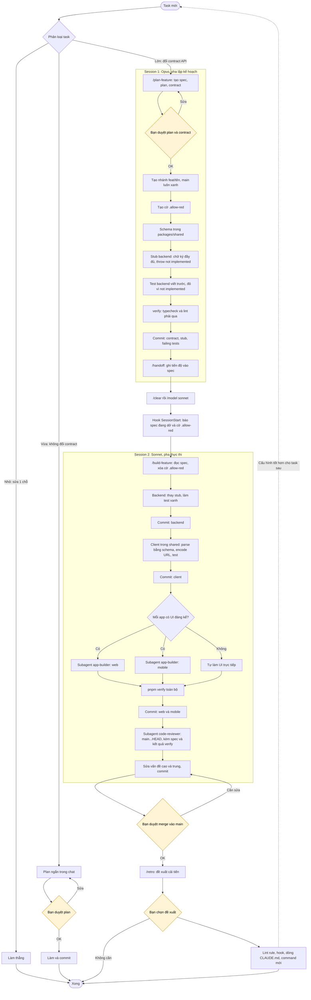
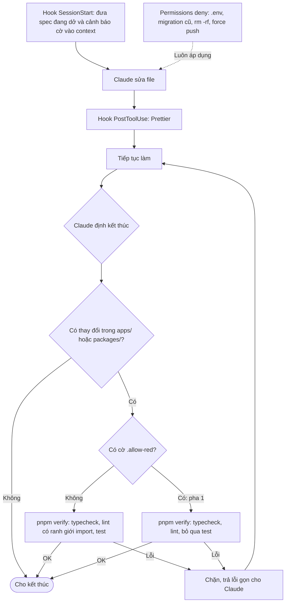

# Quy trình làm việc với Claude Code

> Sơ đồ này phản ánh cấu hình hiện tại trong `.claude/`. Khi đổi command, hook, subagent hay quy tắc phân loại task, cập nhật sơ đồ trong cùng commit.

## Tổng quan

Ô vàng là điểm bạn cần có mặt. Mọi bước khác Claude tự làm.

## Lớp bảo vệ chạy tự động

Các cơ chế này hoạt động ở mọi loại task, không cần gọi.

## Khi nào đổi model

| Giai đoạn                   | Model  | Lý do                                                 |
| --------------------------- | ------ | ----------------------------------------------------- |
| Pha 1: plan, contract, test | Opus   | Cần tư duy; sai ở đây tốn nhất.                       |
| Pha 2: code, subagent       | Sonnet | Nhiều token, đã có test làm trọng tài.                |
| Task nhỏ và vừa             | Sonnet | Đủ cho phạm vi hẹp.                                   |
| Đổi model                   | —      | Chỉ ngay sau `/clear`, để không làm mất prompt cache. |
