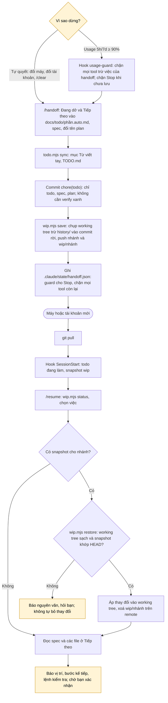

# Đổi máy hoặc tài khoản

Mọi trạng thái để làm tiếp nằm trong repo: todo (`TODO.md`, `docs/todo/`), spec, plan (`docs/plans/`), ADR, log prompt; code dở nằm ở ref `wip/<nhánh>` trên remote. Memory tự động của Claude tắt cho dự án.

Todo hai lớp: `docs/todo/<phần>.md` bạn viết tay (Claude chỉ đọc, chỉ được đánh `[x]`), `docs/todo/<phần>.auto.md` Claude ghi qua `/todo` và `/handoff`. `TODO.md` sinh tự động, trỏ tới cả hai.
