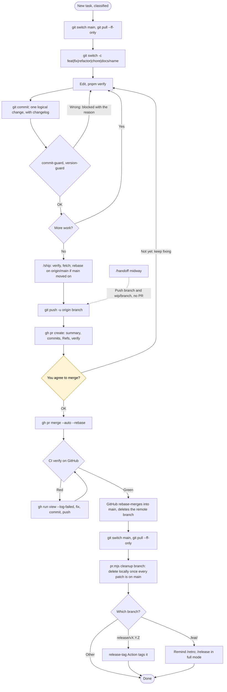

# Git flow through GitHub

`main` only accepts changes through PRs. GitHub rebase-merges when the `verify` job is green (ruleset set by `scripts/github-setup.sh`). Full conventions: [GIT.md](../GIT.md).

- Claude never pushes `main` and never force-pushes. If a pushed branch needs a rebase, it stops and asks you.
- `gh pr merge` is in `ask` in `settings.json`: on top of the question in chat, the tool asks once more.
- Rebase-merge creates new commits on `main`, so `git branch -d` refuses to delete the branch. Use `node scripts/pr.mjs cleanup <branch>` (compares patches). The SessionStart hook lists branches to clean up.
