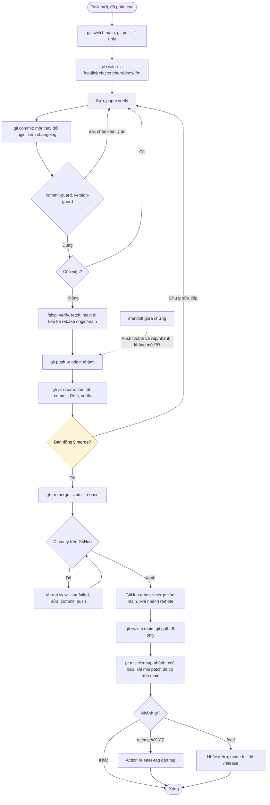

# Git flow qua GitHub

`main` chỉ nhận thay đổi qua PR. GitHub merge bằng rebase khi job `verify` xanh (ruleset do `scripts/github-setup.sh` đặt). Quy ước đầy đủ: [GIT.md](../GIT.md).

- Claude không bao giờ push `main`, không force push. Nếu nhánh đã push rồi lại phải rebase thì dừng và hỏi bạn.
- `gh pr merge` nằm trong `ask` của `settings.json`: ngoài câu hỏi trong chat, công cụ cũng hỏi lại một lần.
- Rebase-merge tạo commit mới trên `main`, nên `git branch -d` từ chối xoá nhánh. Dùng `node scripts/pr.mjs cleanup <nhánh>` (so theo patch). Hook SessionStart liệt kê các nhánh cần dọn.
