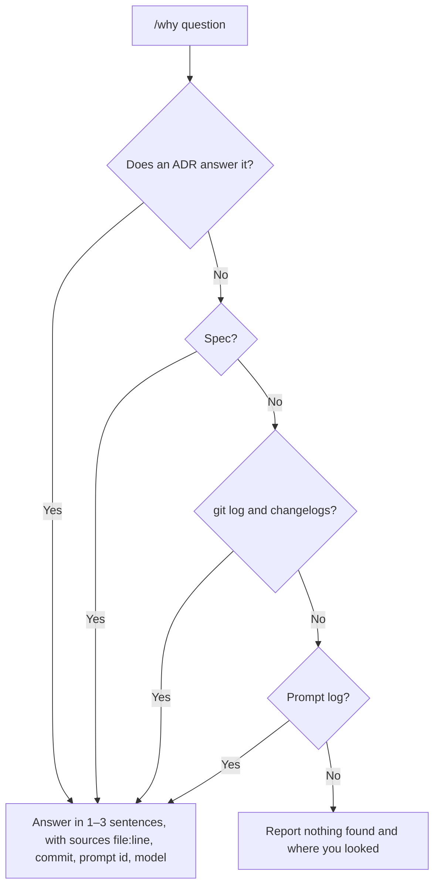

# History and lookup

Every prompt is logged to `history/prompts/` (committed to git, outside versioning, without answers, in the user's own language). Every contested decision becomes an ADR in `docs/decisions/`; broad decisions have an R.

