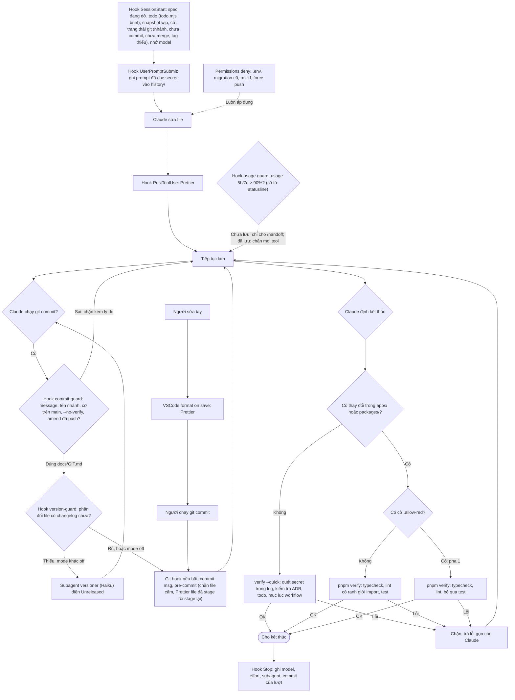

# Lớp bảo vệ chạy tự động

Các cơ chế này hoạt động ở mọi loại task, không cần gọi.

Commit có file todo viết tay (`docs/todo/<phần>.md`): pre-commit (người) hoặc commit-guard (Claude, khi chưa bật `.githooks`) chạy `todo.mjs sync` và stage file auto + `TODO.md` vào cùng commit. `verify` chạy `todo.mjs check` để tổng quan không lệch.

Quy ước git đầy đủ (commit message, nhánh, merge, tag, lệnh cấm): [GIT.md](../GIT.md), nạp vào mọi session qua `CLAUDE.md`.
