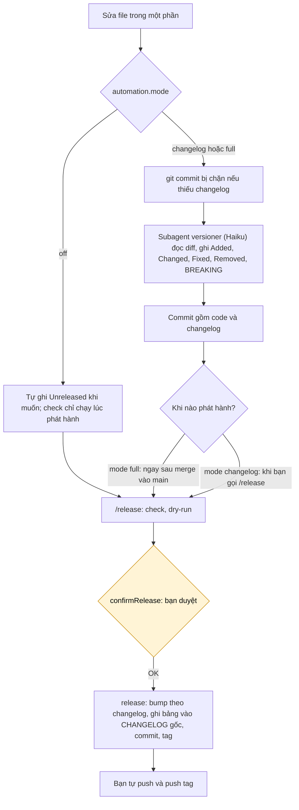

# Phát hành version

Mỗi phần có version và changelog riêng; toàn dự án có version và tag `vX.Y.Z`. Bảng phần → đường dẫn và cấu hình tự động nằm trong `versions.json`:

```json
"automation": { "mode": "changelog", "confirmRelease": true }
```

`off`: không tự động, không chặn commit · `changelog` (mặc định): chặn commit thiếu changelog, `versioner` tự điền · `full`: như `changelog` + tự `/release` sau khi merge. Tắt cho một session: `CLAUDE_AUTO_VERSION=off`.



Mức bump suy ra từ mục `Unreleased`: có `### Removed` hoặc chữ `BREAKING` → major; có `### Added` → minor; còn lại → patch. Ở giai đoạn `0.x`, major được hạ xuống minor.
