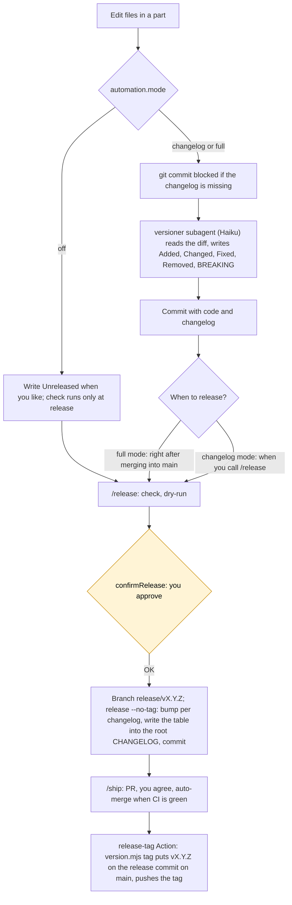

# Releasing a version

Each part has its own version and changelog; the whole project has a version and a `vX.Y.Z` tag. The part → path table and the automation settings live in `versions.json`:

```json
"automation": { "mode": "changelog", "confirmRelease": true }
```

`off`: no automation, commits never blocked · `changelog` (default): commits missing a changelog are blocked and `versioner` fills it · `full`: like `changelog` + `/release` runs after merge. Off for one session: `CLAUDE_AUTO_VERSION=off`.



The bump level comes from `Unreleased`: a `### Removed` section or an entry starting with `BREAKING` → major; `### Added` → minor; otherwise → patch. At `0.x`, major is lowered to minor.
