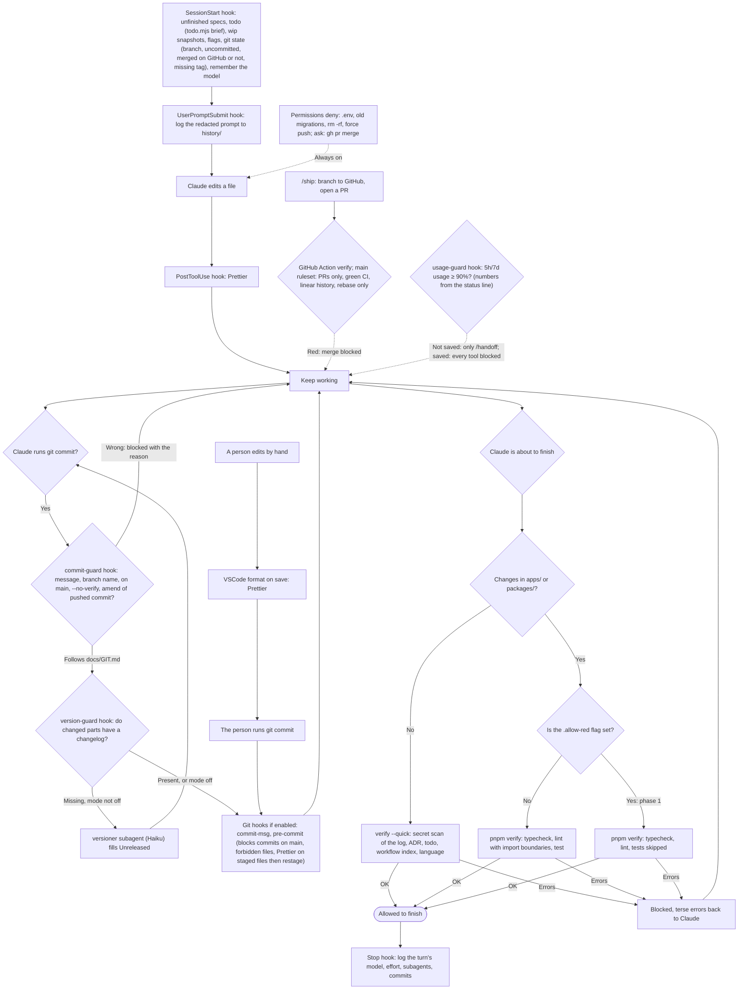

# Automatic safeguards

These mechanisms work on every kind of task without being called.

A commit with a hand-written todo file (`docs/todo/<part>.md`): pre-commit (people) or commit-guard (Claude, when `.githooks` is not enabled) runs `todo.mjs sync` and stages the auto file + `TODO.md` into the same commit. `verify` runs `todo.mjs check` so the overview never drifts, and `lang.mjs check` so the repo stays English (ADR 0020R).

The full git conventions (commit messages, branches, merge, tags, forbidden commands): [GIT.md](../GIT.md), loaded into every session through `CLAUDE.md`.
