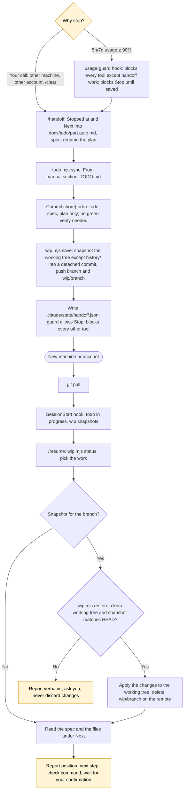

# Switching machine or account

All the state needed to continue lives in the repo: todo (`TODO.md`, `docs/todo/`), specs, plans (`docs/plans/`), ADRs, the prompt log; unfinished code lives at the `wip/<branch>` ref on the remote. Claude's auto memory is off for the project.

Two-layer todo: you write `docs/todo/<part>.md` by hand, in any language (Claude only reads it and may only tick `[x]`); Claude writes `docs/todo/<part>.auto.md` through `/todo` and `/handoff`. `TODO.md` is generated and links to both.
