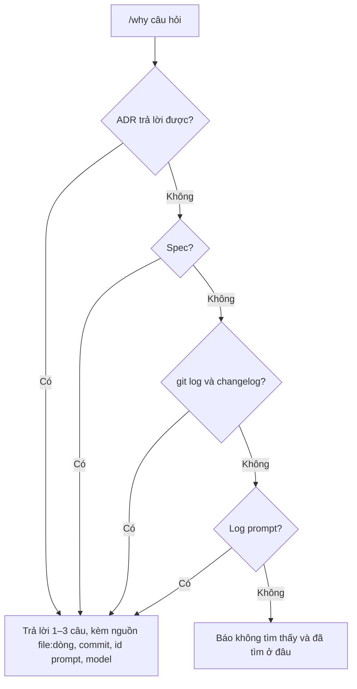

# Lịch sử và tra cứu

Mọi prompt được ghi vào `history/prompts/` (commit lên git, ngoài versioning, không chứa câu trả lời). Mọi quyết định có tranh cãi thành ADR trong `docs/decisions/`; quyết định rộng có chữ R.

